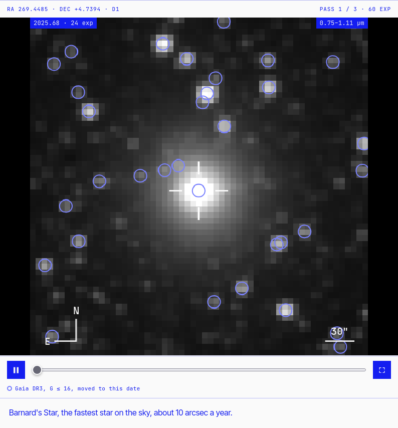
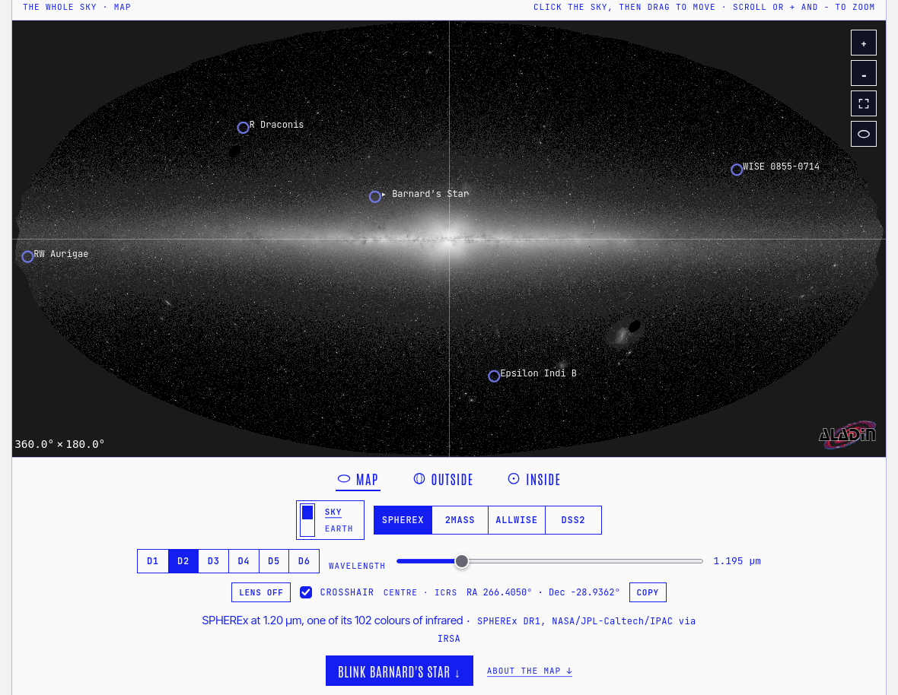
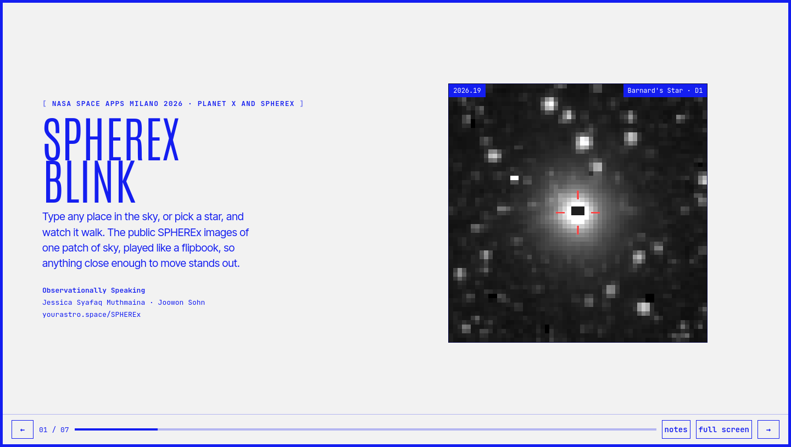
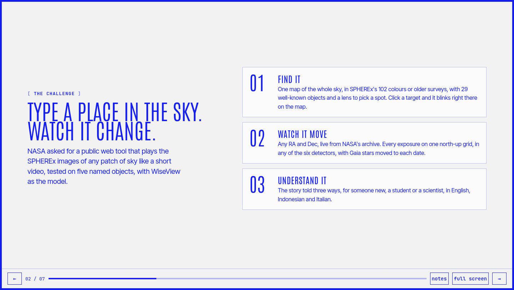
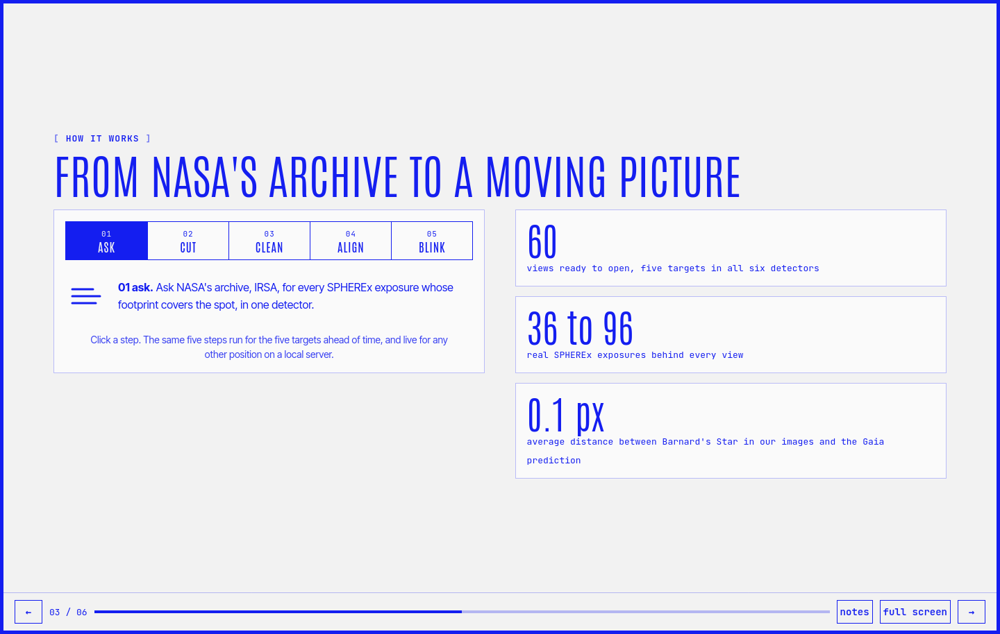
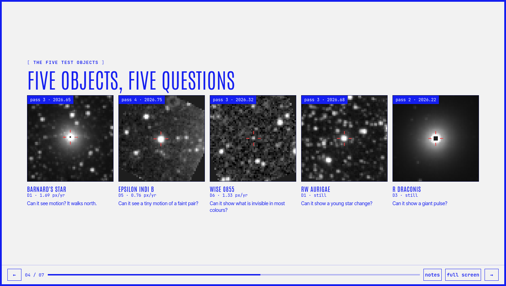
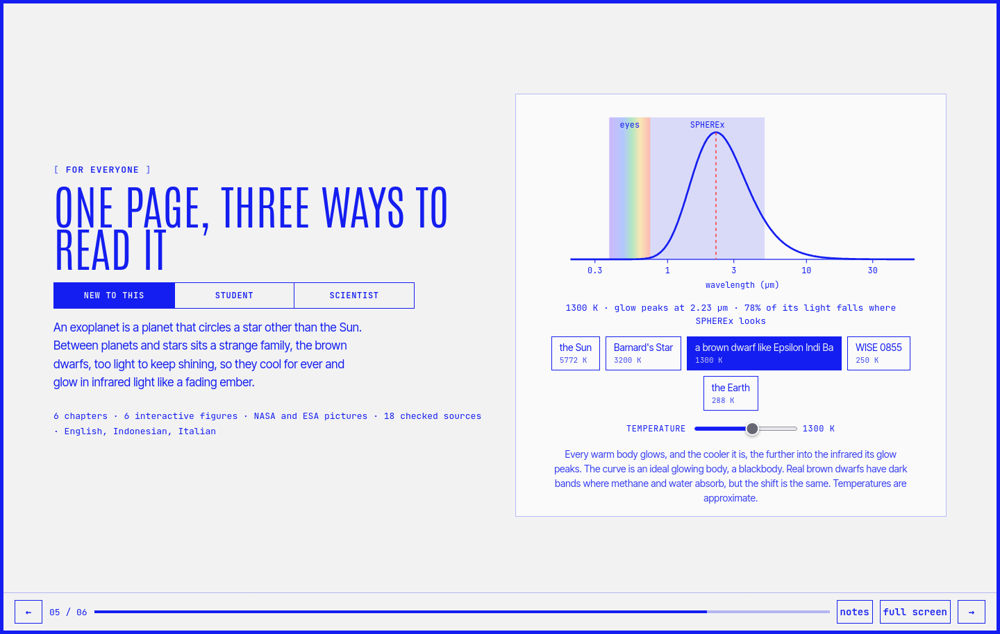
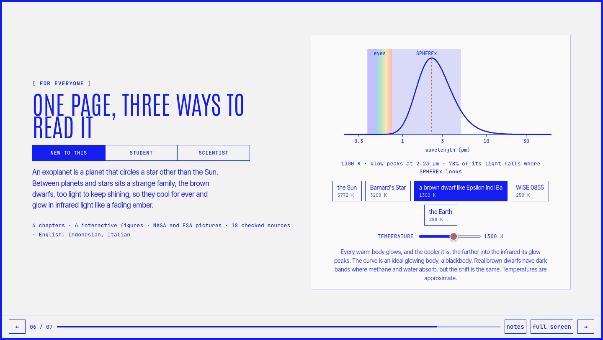
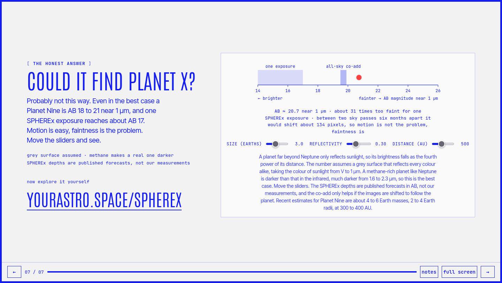

# SPHEREx-site

**SPHEREx Blink**, the `/SPHEREx` page of [yourastro.space](https://www.yourastro.space/SPHEREx/).

Built by the team **Observationally Speaking** at NASA Space Apps Milano, 14 and 15 November 2026,
for the challenge *Planet X and SPHEREx*.

**Live:** [www.yourastro.space/SPHEREx](https://www.yourastro.space/SPHEREx/?target=Barnard)

Type any RA and Dec, or pick a star, and watch it walk. The page plays the public SPHEREx images of one small patch of sky,
one six-month sky pass after another, on one fixed north-up grid, so anything close enough to move
jumps out against the stars behind it. Above it, a whole-sky map shows where that patch sits.

<p align="center">
  
  
</p>

**Slides:** [www.yourastro.space/SPHEREx/slides](https://www.yourastro.space/SPHEREx/slides/), seven
slides with live SPHEREx data on them for the judges, and
[www.yourastro.space/SPHEREx/presentation](https://www.yourastro.space/SPHEREx/presentation/), a
15 minute talk for everyone. More below in [Slides](#slides) and [The talk](#the-talk).

## What is on the page

**01 · Find it on the whole sky.** One interactive map of the entire sky.

- Three shapes: **map** (the whole sky as an oval, Milky Way across the middle), **outside**
  (a slowly turning globe), **inside** (the view from the centre, like a planetarium).
- Surveys: **SPHEREx DR1**, the mission's all-sky release in 102 colours from 0.75 to 5 µm, with
  D1 to D6 buttons and a wavelength slider, and for comparison 2MASS, AllWISE and DSS2.
- The five test targets as markers. Click one and a small card opens beside it on the map, blinking
  that target's sky passes, without moving the page. *Open in the viewer* loads it below.
- 29 **known objects** (Sirius, the Orion Nebula, the Andromeda Galaxy and more), the **Sun** where
  it is today and the **ecliptic**, so a first-time visitor always knows where they are. Thirteen
  show on the whole sky, the rest once you zoom in below 70 degrees. Click one for a short card in
  English, Indonesian or Italian, then **blink it in SPHEREx** to open that spot in the viewer.
- Two **black patches** sit on the ecliptic poles. They are SPHEREx's deep fields, the places it
  looks at most often, and DR1 leaves them out, so there are no images there yet (checked at IRSA
  on 15 November 2026).
- In **full screen** the map fills the window: the settings open over it on request, and the legend
  and centre coordinates sit on the map.
- A full-width crosshair with the centre coordinates, a **lens** you can switch on and drag to
  choose a spot, and a **Home** button that always returns to the same view.

**02 · Watch it move.** The blink viewer.

- Every SPHEREx exposure of a 6 × 6 arcmin field, moved onto one grid, played as a flipbook.
  One image per six-month pass (the median of its exposures) or every single exposure.
- **Blink** or **difference** view. In the difference view whatever never changes turns grey,
  and something that moved leaves a bright spot where it is and a dark spot where it was.
- **Gaia DR3** and **CatWISE2020** circles on top, each star moved to the date of the frame on
  screen with its own proper motion.
- Five targets: Barnard's Star, Epsilon Indi B, WISE 0855-0714, RW Aurigae and R Draconis.
- A **spectrum** of the target from its own exposures. SPHEREx's filter passes a different
  wavelength at every spot of the detector, so each exposure sees the target at its own colour.
  The panel plots the light in a 2-pixel aperture against that wavelength, one dot per exposure,
  and *add the other five detectors* fills in 0.75 to 5 µm. A saturated star is measured from its
  wings, drawn as hollow dots on a relative axis. A full-aperture flux and a wing estimate are on
  different scales, so one plot never mixes them: it shows the kind most exposures have and says how
  many of the other kind it left out. Click a dot to jump to that exposure.
- **Blink one colour only**: keeps the exposures within one or two resolution elements of a chosen
  wavelength, so a change between frames is time and not colour. Without it, R Draconis in D3 is
  seen anywhere from 1.62 to 2.41 µm, right across its water bands. In the URL as `wl`.
- A **measured track**: the target's centroid in each sky pass (the centre of the blank core for a
  saturated star), drawn as orange dots, with the measured motion next to the expected one.
- A **light curve** at one colour: the target's light against the date, with the median of each
  sky pass. RW Aurigae in D1 near 0.92 µm brightens by about half a magnitude from the 2025 pass
  to the 2026 passes. Dust clearing from the line of sight would look like this, but the 2-pixel
  aperture also holds the companion 1.45″ away, so we do not claim it without a check in the other
  detectors. The panel says so under every light curve.
- A **fake mover**, as in WiseView: a point source with the SPHEREx PSF (FWHM 7.5″) and a chosen
  magnitude, speed and direction, added to every real exposure, with presets from easy to
  Planet Nine-like. Turn the mark off and see whether you can still find it.
- **Next field** north, south, east or west, a **random spot**, and **report a candidate**, which
  opens a GitHub issue with the exact view and the checks a volunteer should make first.
- **Any other position**: type RA and Dec (with a proper motion if you like) under *your own
  position*, drag the lens on the map, or press *blink it in SPHEREx* on a known object. The page
  fetches every SPHEREx DR1 exposure of that spot live from IRSA, which takes about half a minute.
- **Find an exoplanet host by name**: in the same panel, type a planet or host star (TRAPPIST-1,
  51 Peg, Barnard) and pick it from the list. Position and proper motion come from the
  [NASA Exoplanet Archive](https://exoplanetarchive.ipac.caltech.edu/) Planetary Systems Composite
  table and go straight into the form, with epoch 2015.5 (the archive's positions are Gaia DR2 at that
  epoch, checked on Barnard's Star). The archive sends no CORS headers either, so the search goes
  through the relay (`op=exo`). *Browse the full archive table* opens the archive's own table in a
  window on the page, for anyone who wants to filter it and copy RA and Dec by hand.

On a wide screen the viewer stays in sight while the settings beside it scroll, so every change is
seen as it happens. Both the map and the viewer have a **full screen** view. Every setting lives in the address, so a
link opens exactly the same view for someone else. The page is in English, Indonesian and Italian,
with a light and a dark theme.

## How it works

For each field the data path asks NASA/IPAC IRSA for every SPHEREx Level 2 exposure that covers it,
moves the target to each exposure date with its proper motion, downloads small cutouts in parallel,
subtracts the zodiacal light model in each file, and resamples everything onto one fixed TAN grid of
6.15 arcsec pixels. Barnard's Star lands on average within a tenth of a pixel of where Gaia predicts.

The five targets ship as compact JSON in `data/`, so they open at once. Any other position goes
through a small relay function on yourastro.space, `api/spherex.js` in the main site's repository,
because IRSA sends no CORS headers and a browser cannot read the cutouts itself. The relay runs the
same steps as `tool/spherex_frames.py` without astropy:

1. `op=find` asks IRSA's SIA service for every SPHEREx DR1 exposure covering the point, about 3 s.
2. `op=frame` downloads one cutout but stops after the IMAGE, FLAGS and ZODI extensions (about
   60 kB of the 4 MB file, the rest is a PSF table), subtracts the zodiacal light, masks flagged
   pixels if asked, maps every grid pixel through the TAN-SIP header with the inverse polynomial,
   and resamples bilinearly onto the page's north-up grid. The wavelength at the target comes from
   the WAVE-TAB lookup table of each detector, stored in the relay. About 1 s per exposure, six at
   a time.
3. `op=cat` returns Gaia DR3 from ESA's Gaia archive (IRSA as fallback) and CatWISE2020 from IRSA.

Checked against the Python data path on Barnard's Star in all six detectors on 14 November 2026:
the same wavelength to 0.1 nm, the same target pixel to 0.001 px, and pixel values within about
1 percent, which is the int16 packing. The relay only fetches SPHEREx file paths from
irsa.ipac.caltech.edu, so it is not an open proxy. A newer SPHEREx release needs one name changed,
`COLLECTION` at the top of the relay.

## Run it yourself

```bash
conda activate astrolab2          # Python with numpy, scipy and astropy
python tool/server.py             # then open http://localhost:8000/?target=Barnard
python tool/export_static.py      # rebuilds data/ after a change to the data path
```

The local server uses astropy and keeps the full cutouts in `~/spherex_data`, so a field opens at
once the second time. It also takes fields up to 900 arcsec, against 600 on the site.

## Files

| Path | What it is |
|---|---|
| `index.html`, `style.css`, `app.js` | the page, in the yourastro.space design |
| `data/` | the five targets as static JSON, with and without flagged pixels |
| `data/bands/` | each target in all six detectors, read by the page's D1 to D6 switch, built by the GitHub workflow below |
| `data/targets.json` | the five targets, what kind of object each is, why it is in the set and what to look for |
| `img/` | `og.png`, the picture for link previews, and `story/`, the photographs in the story and the talk. The Earth images are no longer shown |
| `tool/spherex_frames.py` | the data path, `get_frames()` |
| `known.js` | the 29 known objects, the Sun and the ecliptic on the sky map, text in three languages |
| `tool/server.py` | local server for the page, `/api/frames` and `/api/progress` |
| `api/spherex.js` (main site repo) | the relay on yourastro.space that serves any other position |
| `tool/export_static.py` | writes `data/` |
| `tool/export_all_bands.py` | writes `data/bands/` |
| `tool/earth_mollweide.py` | made the Earth images in `img/`, no longer used on the page |
| `.github/workflows/export-bands.yml` | runs `export_all_bands.py` on GitHub |
| `docs/release/` | the release document, LaTeX and PDF |
| `docs/img/` | the screenshots in this README |
| `slides/index.html`, `slides/data/` | the seven slides, and the Kapteyn's Star view fetched through the relay for slide 5 |
| `presentation/index.html`, `presentation/img/` | the 15 minute talk, with the Kaushik et al. 2024 figure and Tombaugh's Pluto plates |
| `tool/README.md` | URL parameters, keys, overlays, data format |
| `prep/` | our test notebook and scripts of 10 November 2026 |

The page is served through GitHub Pages and shown at `yourastro.space/SPHEREx` by a rewrite in the
main site's `vercel.json`.

## Every detector, exported on GitHub

The workflow *Export all detectors* builds `data/bands/<target>_<D1..D6>.json` on GitHub's own
machines, so the SPHEREx cutouts are never downloaded to a laptop. Start it by hand from the Actions
tab. Each target runs as its own job, and files that already exist are skipped, so a stopped run
picks up where it left off. The workflow never commits. The files come back as one zip per target
under Artifacts on the run page, to unzip into `data/bands/` and commit yourself.

## Aladin + SPHEREx Time Lens

[Open the Time Lens](https://spherex-time-lens.arisenhutch4.chatgpt.site/?target=Barnard), our
teammate's prototype.

Explore the sky with Aladin Lite and view the corresponding SPHEREx preset in a rectangular Time
Lens panel. This independently hosted integration embeds the existing viewer and preserves its
scientific features. Its list of known objects, fact-checked, is now on the main page's sky map.

Its ideas now also live inside the main page: the Aladin sky map around the SPHEREx field, the full
crosshair, the lens you switch on and drag, the fixed Home and the D1 to D6 buttons, which on the main
page switch the map to real SPHEREx DR1 imagery.

## Slides

The deck is a web page in the same design, `slides/index.html`, shown at
[www.yourastro.space/SPHEREx/slides](https://www.yourastro.space/SPHEREx/slides/). The images on it
are real SPHEREx frames read from `data/`, and the figures can be clicked. Slide 5 plays Kapteyn's
Star, which is not one of the five targets, from a view saved through the relay on 14 November 2026. Arrow keys move between
slides, `n` shows the speaker notes and `f` goes full screen.

| | |
|---|---|
|  |  |
| **1.** Title, with Barnard's Star blinking | **2.** The challenge and what the page does |
|  |  |
| **3.** The data path in five steps | **4.** The five test objects |
|  |  |
| **5.** Any position, with Kapteyn's Star | **6.** The story at three reading levels |
|  | |
| **7.** Could it find Planet X? | |

## The talk

A 15 minute story for a general audience, `presentation/index.html`, shown at
[www.yourastro.space/SPHEREx/presentation](https://www.yourastro.space/SPHEREx/presentation/). It
tells how planets around other stars are found as six settings of a camera: transit as the light
meter, radial velocity as white balance, astrometry as camera shake, direct imaging as the lens
hood, microlensing as a zoom lens made of gravity, and timing as the clock. Then it shows the whole
menu on Fig. 1 of Kaushik, Mattoo and Rastogi 2024
([arXiv:2404.09143](https://arxiv.org/abs/2404.09143), CC BY 4.0) with today's counts added, and
turns to SPHEREx as a slow camera with 102 colours: Tombaugh's Pluto plates, Barnard's Star walking
(the star of the 1963 astrometric false alarm, which turned out to have four small planets found in
2024 and 2025), WISE 0855 appearing only in D6, an honest answer about Planet X, and a QR code to
try the page.

Every click, arrow key or clicker press is one step, so the presenter only ever presses next.
`p` opens a presenter window in sync (script, clock, what the next click does), `n` shows the notes
on the main screen, `b` blanks it and `f` goes full screen. The script is about 1,800 words, about
14 minutes. Planet counts are from the NASA Exoplanet Archive on 15 November 2026.

## What it cannot do

- **It will not find Planet X.** A Planet Nine of the proposed size and distance (2 to 4 Earth radii,
  300 to 500 AU) is about AB 18 to 21 near 1 µm even for a grey surface, and a methane-rich planet
  like Neptune is darker still in the infrared. One SPHEREx exposure reaches about AB 17, so that is
  up to 40 times too faint, and the median of a sky pass does not
  help because the planet moves several pixels between exposures. Motion is never the problem,
  faintness is. Chapter 6 of the story and the fake mover let you check this yourself on real frames.
- It finds bright, slow, nearby movers (stars and brown dwarfs within a few tens of parsecs) and
  changes in brightness of objects bright enough to stand above the noise in one exposure.
- Very bright stars saturate, so their brightness is measured from the wings, relative only.
- The aperture measures whatever sits in it, so a faint target beside a star shows the star.
- A new position takes about half a minute, the field is at most 600 arcsec on the site, and
  CatWISE2020 depends on IRSA's TAP service.

## Does it measure the right thing?

The measured track, on the five targets in their best detector (14 November 2026). Expected is the
proper motion of Table 2 in the release document.

| Target | Detector | Measured | Expected | Note |
|---|---|---|---|---|
| Barnard's Star | D1 | 10.4″/yr | 10.4″/yr | saturated core, centre of the blank patch |
| Epsilon Indi B | D5 | 4.6″/yr | 4.7″/yr | |
| WISE 0855-0714 | D6 | 8.5″/yr | 8.2″/yr | very faint, a pass counts only with a 5σ detection |
| RW Aurigae | D1 | 0.2″/yr | 0.0″/yr | does not move |
| R Draconis | D3 | 2.1″/yr | 0.0″/yr | saturated, does not move |
| Kapteyn's Star (any position) | D1 | 8.3″/yr | 8.6″/yr | through the relay, not one of the five |

## The challenge, and where we stand

Our teammate's reading of the *Planet X and SPHEREx* brief, with what the page does today. P0 is
what NASA requires, P1 and P2 are NASA's optional ideas in our order of priority. Finding Planet X
is not a required outcome, and no live telescope stream is asked for, only observations taken at
different times.

| Priority | Feature | NASA | Status |
|---|---|---|---|
| P0 | Public web application | Core | Done, [yourastro.space/SPHEREx](https://www.yourastro.space/SPHEREx/) |
| P0 | Sky position by RA and Dec | Core | Done, any position on the live page through the relay, in the form, the lens or a known object, and as `ra` and `dec` in the URL |
| P0 | Real SPHEREx images | Core | Done, Level 2 exposures from IRSA |
| P0 | Observations in time order, as an animation | Core | Done, every exposure or one median per six-month pass |
| P0 | Test on the five named targets | Core | Done, all five in all six detectors |
| P1 | Detectors D1 to D6 and spectral bands | Optional | Done for D1 to D6 in the viewer, and the 102 colours of DR1 on the sky map |
| P1 | Difference imaging and stacking | Optional | Done, difference view and pass medians |
| P1 | Adjustable field of view | Optional | Done, 20 to 600 arcsec in the form and as `size` in the URL, 900 on the local server. The five targets ship at 360 arcsec |
| P1 | New SPHEREx releases | Optional | Any position is fetched live, so new DR1 exposures appear by themselves. A new release is one name in the relay, and the export workflow rebuilds the five targets |
| P2 | Gaia and WISE overlays | Optional | Done, Gaia DR3 and CatWISE2020 moved to each frame's date |
| P2 | Shareable coordinate URLs | Optional | Done, every setting lives in the URL |
| P2 | Quality and contamination flags | Optional | Flagged pixels can be masked. Saturated cores are detected and measured from the wings. Per-frame flag counts are not shown yet |
| P2 | Spectra made on the fly | Optional, advanced | Done, from the exposures themselves, in one detector or all six, for the five targets and for any position |
| | Use existing software | Suggested | Astropy for the data path, Aladin Lite for the sky map |

The priority is a reliable viewer that lets anyone pick a patch of sky and see what changed, ahead
of more secondary features.

## prep/

The `prep/` folder holds the test notebook and two scripts made on 10 November 2026 to check that
the SPHEREx data path works before the hackathon. The Local Lead confirmed on 14 November that
reusing them is fine, and they are cited as our earlier work. See `prep/README.md` to run it and
`prep/GUIDE.md` for a step-by-step walk through the notebook.

## Credits

- **Images:** SPHEREx DR1 Spectral Images,
  [doi:10.26131/IRSA678](https://doi.org/10.26131/IRSA678), and the SPHEREx DR1 Spectral All-Sky Cube,
  [doi:10.26131/IRSA679](https://doi.org/10.26131/IRSA679), NASA/JPL-Caltech/IPAC, through the
  [NASA/IPAC Infrared Science Archive](https://irsa.ipac.caltech.edu/Missions/spherex.html).
- **Software:** Astropy, NumPy and SciPy for the Python data path; Aladin Lite for the sky map. The
  relay and the page use no outside libraries. The talk draws its QR code with qrcodejs.
- **Known objects:** the list from our teammate's Time Lens, positions from SIMBAD (CDS).
- **Positions and motions:** Gaia DR3 (ESA/DPAC). For WISE 0855, AllWISE with the motion of
  Kirkpatrick et al. 2021.
- **Catalogue overlays:** Gaia DR3 and CatWISE2020 (Marocco et al. 2021), both through IRSA.
- **Sky maps:** [Aladin Lite](https://aladin.cds.unistra.fr/) (CDS, Strasbourg), with 2MASS and
  AllWISE through IRSA and DSS2 through ESA.
- **Exoplanet hosts and counts:** NASA Exoplanet Archive, Planetary Systems Composite table
  ([doi:10.26133/NEA13](https://doi.org/10.26133/NEA13)).
- **Talk figures:** Kaushik, Mattoo and Rastogi 2024, Fig. 1, CC BY 4.0; Pluto discovery plates,
  Clyde Tombaugh, Lowell Observatory, public domain; the SPHEREx telescope photo, NASA/JPL-Caltech.
- **Ideas:** the blink follows [WiseView](http://byw.tools/wiseview) by Caselden and collaborators.
  The whole-sky layout follows Brice Menard's [ultraviolet sky map](https://menard.pha.jhu.edu/uvmap/).
  The lens, the crosshair, the fixed Home and the known objects come from our teammate's Time Lens.
  The fake mover follows WiseView's injected test objects.
- **Team:** Observationally Speaking, [yourastrophysicist](https://github.com/yourastrophysicist)
  and [sohnjoo1-collab](https://github.com/sohnjoo1-collab).
- **AI use:** most of the code and much of the text in this repository, and the relay
  `api/spherex.js` in the main site's repository, were written with Claude (Anthropic) during the
  event, from the team's instructions, and the Time Lens prototype with Codex (OpenAI). The team set
  the goals and the design, decided what to keep, checked the results against IRSA and Gaia (the
  measured tracks, the relay against the Python path, the known-object facts against SIMBAD), and is
  responsible for the content. Every code file says so in its first lines, and the page and the
  slides and the talk carry an `ai-disclosure` meta tag. The talk's story follows Jessica's
  Exoplanetary Astrophysics lecture notes. The prep scripts of 10 November in `prep/` were made
  before the event, partly with Claude, and are used with the Local Lead's agreement.
