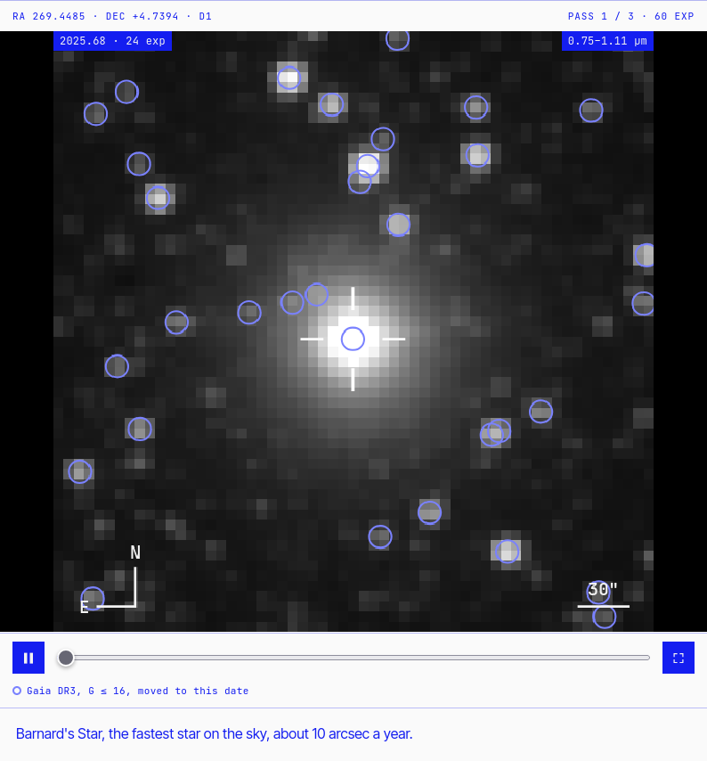
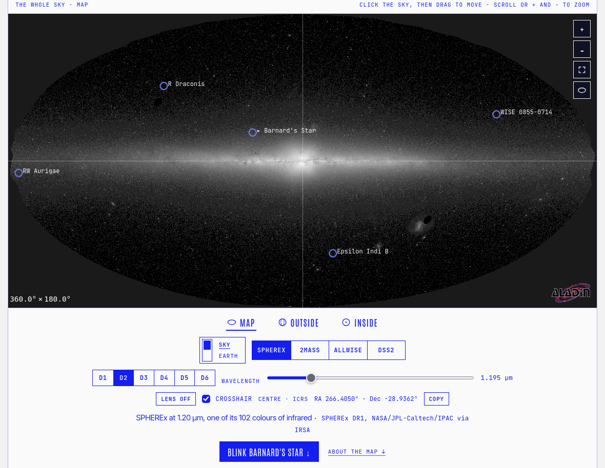
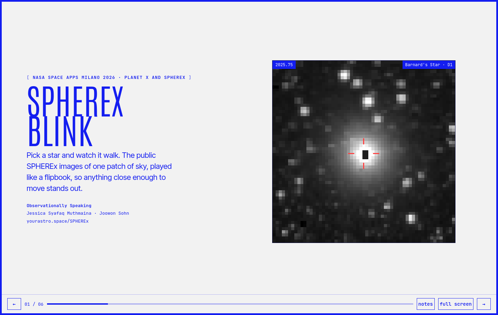
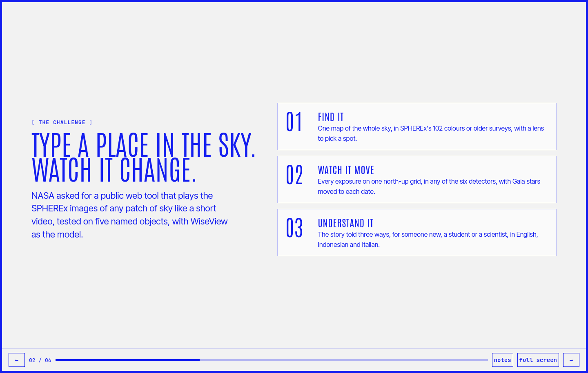
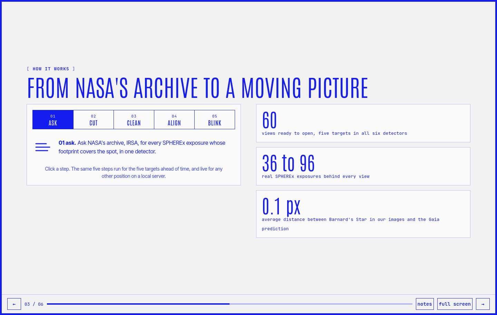
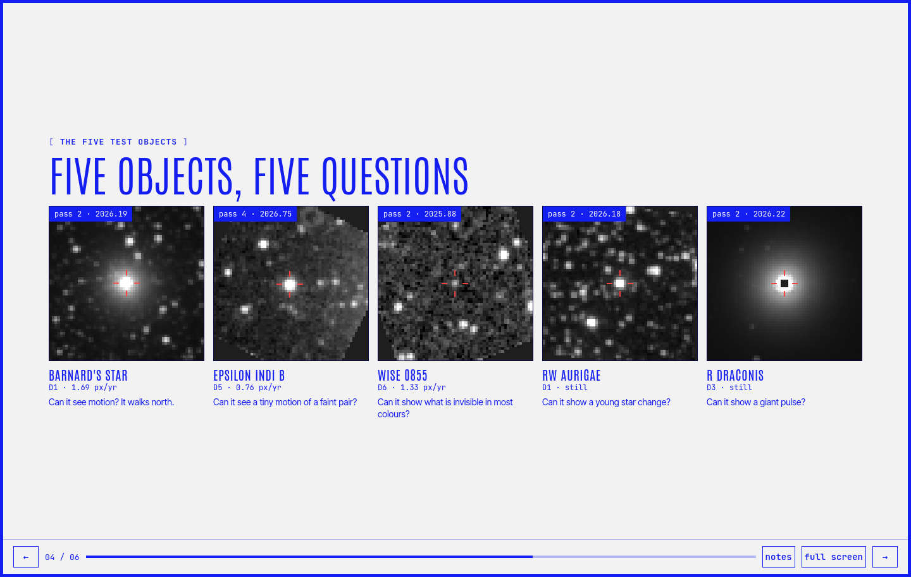
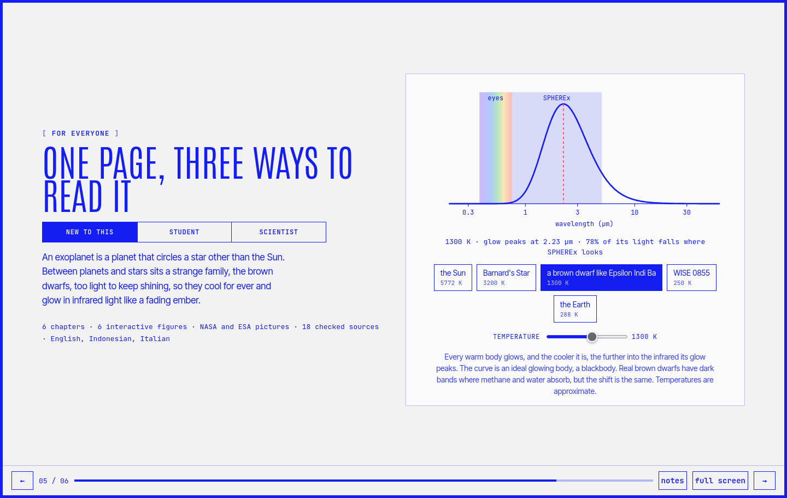
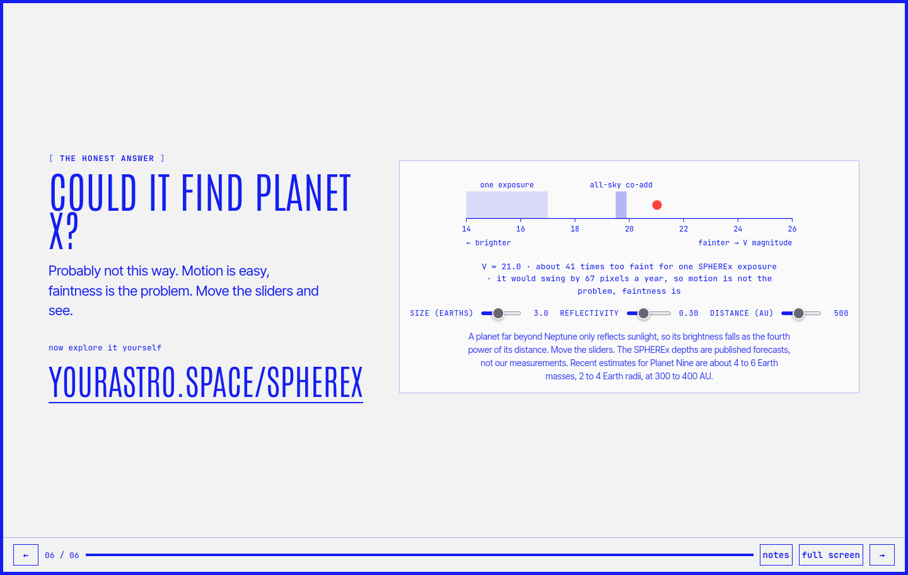

# SPHEREx-site

**SPHEREx Blink**, the `/SPHEREx` page of [yourastro.space](https://www.yourastro.space/SPHEREx/).

Built by the team **Observationally Speaking** at NASA Space Apps Milano, 14 and 15 November 2026,
for the challenge *Planet X and SPHEREx*.

**Live:** [www.yourastro.space/SPHEREx](https://www.yourastro.space/SPHEREx/?target=Barnard)

Pick a star and watch it walk. The page plays the public SPHEREx images of one small patch of sky,
one six-month sky pass after another, on one fixed north-up grid, so anything close enough to move
jumps out against the stars behind it. Above it, a whole-sky map shows where that patch sits.

<p align="center">
  
  
</p>

**Slides:** [www.yourastro.space/SPHEREx/slides](https://www.yourastro.space/SPHEREx/slides/), six
slides with live SPHEREx data on them. More below in [Slides](#slides).

## What is on the page

**01 · Find it on the whole sky.** One interactive map of the entire sky.

- Three shapes: **map** (the whole sky as an oval, Milky Way across the middle), **outside**
  (a slowly turning globe), **inside** (the view from the centre, like a planetarium).
- A **sky / Earth** switch. Earth shows the planet SPHEREx circles, by day and at night.
- Surveys: **SPHEREx DR1**, the mission's all-sky release in 102 colours from 0.75 to 5 µm, with
  D1 to D6 buttons and a wavelength slider, and for comparison 2MASS, AllWISE and DSS2.
- The five test targets as markers. Click one to load it in the viewer below.
- A full-width crosshair with the centre coordinates, a **lens** you can switch on and drag to
  choose a spot, and a **Home** button that always returns to the same view.

**02 · Watch it move.** The blink viewer.

- Every SPHEREx exposure of a 6 × 6 arcmin field, moved onto one grid, played as a flipbook.
  One image per six-month pass (the median of its exposures) or every single exposure.
- **Blink** or **difference** view. In the difference view whatever never changes turns grey,
  and something that moved leaves a bright spot where it is and a dark spot where it was.
- **Gaia DR3** and **CatWISE2020** circles on top, each star moved to the date of the frame on
  screen with its own proper motion.
- Five targets: Barnard's Star, Epsilon Indi B, WISE 0855-0714, RW Aurigae and R Draconis.

Both the map and the viewer have a **full screen** view. Every setting lives in the address, so a
link opens exactly the same view for someone else. The page is in English, Indonesian and Italian,
with a light and a dark theme.

## How it works

For each field the data path asks NASA/IPAC IRSA for every SPHEREx Level 2 exposure that covers it,
moves the target to each exposure date with its proper motion, downloads small cutouts in parallel,
subtracts the zodiacal light model in each file, and resamples everything onto one fixed TAN grid of
6.15 arcsec pixels. Barnard's Star lands on average within a tenth of a pixel of where Gaia predicts.

The page is static. The five targets ship as compact JSON in `data/`, so they open at once on
GitHub Pages. Any other position needs the Python data server in `tool/`, run on your own computer.

## Run it yourself

```bash
conda activate astrolab2          # Python with numpy, scipy and astropy
python tool/server.py             # then open http://localhost:8000/?target=Barnard
python tool/export_static.py      # rebuilds data/ after a change to the data path
```

The first view of a new field downloads every cutout from IRSA, which takes a few minutes. After
that the files are cached in `~/spherex_data` and the field opens at once.

## Files

| Path | What it is |
|---|---|
| `index.html`, `style.css`, `app.js` | the page, in the yourastro.space design |
| `data/` | the five targets as static JSON, with and without flagged pixels |
| `data/bands/` | each target in all six detectors, read by the page's D1 to D6 switch, built by the GitHub workflow below |
| `data/targets.json` | the five targets, what kind of object each is, why it is in the set and what to look for |
| `img/` | the Earth by day and at night, in the same oval as the sky map |
| `tool/spherex_frames.py` | the data path, `get_frames()` |
| `tool/server.py` | local server for the page, `/api/frames` and `/api/progress` |
| `tool/export_static.py` | writes `data/` |
| `tool/export_all_bands.py` | writes `data/bands/` |
| `tool/earth_mollweide.py` | makes the Earth images in `img/` |
| `.github/workflows/export-bands.yml` | runs `export_all_bands.py` on GitHub |
| `docs/release/` | the release document, LaTeX and PDF |
| `docs/img/` | the screenshots in this README |
| `slides/index.html` | the six slides |
| `tool/README.md` | URL parameters, keys, overlays, data format |
| `prep/` | our test notebook and scripts of 10 November 2026 |

The page is served through GitHub Pages and shown at `yourastro.space/SPHEREx` by a rewrite in the
main site's `vercel.json`.

## Every detector, exported on GitHub

The workflow *Export all detectors* builds `data/bands/<target>_<D1..D6>.json` on GitHub's own
machines, so the SPHEREx cutouts are never downloaded to a laptop. Start it by hand from the Actions
tab. Each target runs as its own job, and files that already exist are skipped, so a stopped run
picks up where it left off. The workflow never commits. The files come back as one zip per target
under Artifacts on the run page, to unzip into `data/bands/` and commit yourself.

## Aladin + SPHEREx Time Lens

[Open the Time Lens](https://spherex-time-lens.arisenhutch4.chatgpt.site/?target=Barnard), our
teammate's prototype.

Explore the sky with Aladin Lite and view the corresponding SPHEREx preset in a rectangular Time
Lens panel. This independently hosted integration embeds the existing viewer and preserves its
scientific features. The public integration uses static presets. Arbitrary RA/Dec positions require
the live server described in `tool/README.md`.

Its ideas now also live inside the main page: the Aladin sky map around the SPHEREx field, the full
crosshair, the lens you switch on and drag, the fixed Home and the D1 to D6 buttons, which on the main
page switch the map to real SPHEREx DR1 imagery.

## Slides

The deck is a web page in the same design, `slides/index.html`, shown at
[www.yourastro.space/SPHEREx/slides](https://www.yourastro.space/SPHEREx/slides/). The images on it
are real SPHEREx frames read from `data/`, and the figures can be clicked. Arrow keys move between
slides, `n` shows the speaker notes and `f` goes full screen.

| | |
|---|---|
|  |  |
| **1.** Title, with Barnard's Star blinking | **2.** The challenge and what the page does |
|  |  |
| **3.** The data path in five steps | **4.** The five test objects |
|  |  |
| **5.** The story at three reading levels | **6.** Could it find Planet X? |

## The challenge, and where we stand

Our teammate's reading of the *Planet X and SPHEREx* brief, with what the page does today. P0 is
what NASA requires, P1 and P2 are NASA's optional ideas in our order of priority. Finding Planet X
is not a required outcome, and no live telescope stream is asked for, only observations taken at
different times.

| Priority | Feature | NASA | Status |
|---|---|---|---|
| P0 | Public web application | Core | Done, [yourastro.space/SPHEREx](https://www.yourastro.space/SPHEREx/) |
| P0 | Sky position by RA and Dec | Core | `ra` and `dec` in the URL work with the local server in `tool/`. The public page opens the five targets only |
| P0 | Real SPHEREx images | Core | Done, Level 2 exposures from IRSA |
| P0 | Observations in time order, as an animation | Core | Done, every exposure or one median per six-month pass |
| P0 | Test on the five named targets | Core | Done, all five in all six detectors |
| P1 | Detectors D1 to D6 and spectral bands | Optional | Done for D1 to D6 in the viewer, and the 102 colours of DR1 on the sky map |
| P1 | Difference imaging and stacking | Optional | Done, difference view and pass medians |
| P1 | Adjustable field of view | Optional | `size` up to 900 arcsec on the local server. The five targets ship at 360 arcsec |
| P1 | New SPHEREx releases | Optional | The export scripts and the GitHub workflow can be run again |
| P2 | Gaia and WISE overlays | Optional | Done, Gaia DR3 and CatWISE2020 moved to each frame's date |
| P2 | Shareable coordinate URLs | Optional | Done, every setting lives in the URL |
| P2 | Quality and contamination flags | Optional | Flagged pixels can be masked. Per-frame flags are not shown yet |
| P2 | Spectra made on the fly | Optional, advanced | Not done |
| | Use existing software | Suggested | Astropy for the data path, Aladin Lite for the sky map |

The priority is a reliable viewer that lets anyone pick a patch of sky and see what changed, ahead
of more secondary features.

## prep/

The `prep/` folder holds the test notebook and two scripts made on 10 November 2026 to check that
the SPHEREx data path works before the hackathon. The Local Lead confirmed on 14 November that
reusing them is fine, and they are cited as our earlier work. See `prep/README.md` to run it and
`prep/GUIDE.md` for a step-by-step walk through the notebook.

## Credits

- **Images:** SPHEREx Level 2 spectral images and the SPHEREx DR1 all-sky cube,
  NASA/JPL-Caltech/IPAC, through the [NASA/IPAC Infrared Science Archive](https://irsa.ipac.caltech.edu/Missions/spherex.html).
- **Positions and motions:** Gaia DR3 (ESA/DPAC). For WISE 0855, AllWISE with the motion of
  Kirkpatrick et al. 2021.
- **Catalogue overlays:** Gaia DR3 and CatWISE2020 (Marocco et al. 2021), both through IRSA.
- **Sky maps:** [Aladin Lite](https://aladin.cds.unistra.fr/) (CDS, Strasbourg), with 2MASS and
  AllWISE through IRSA and DSS2 through ESA.
- **Earth:** Blue Marble and Black Marble, NASA, through NASA GIBS.
- **Ideas:** the blink follows [WiseView](http://byw.tools/wiseview) by Caselden and collaborators.
  The whole-sky layout follows Brice Menard's [ultraviolet sky map](https://menard.pha.jhu.edu/uvmap/).
  The lens, the crosshair and the fixed Home come from our teammate's Time Lens.
- **Team:** Observationally Speaking, [yourastrophysicist](https://github.com/yourastrophysicist)
  and [sohnjoo1-collab](https://github.com/sohnjoo1-collab).
- **AI use:** parts of the code and of the text were written with help from Claude (Anthropic),
  and the Time Lens prototype with help from Codex (OpenAI).
